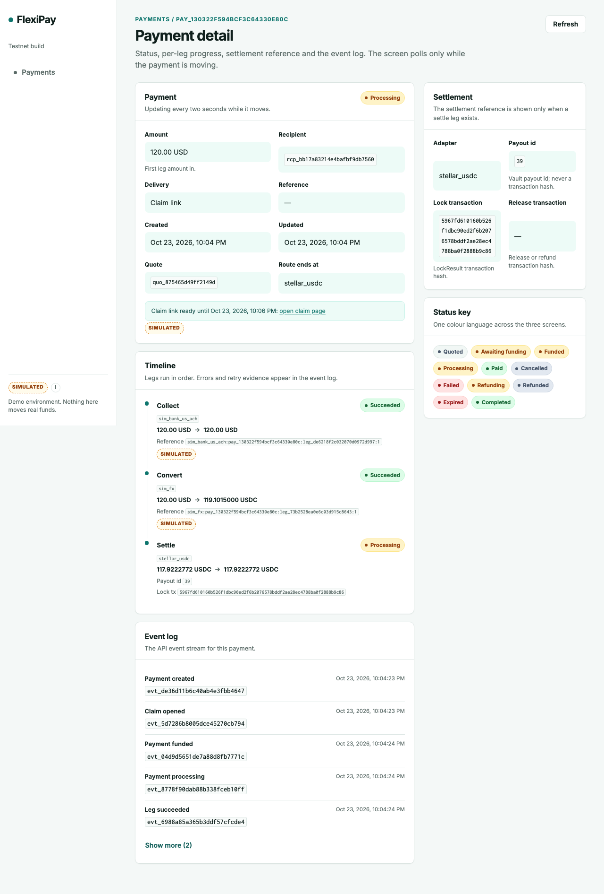
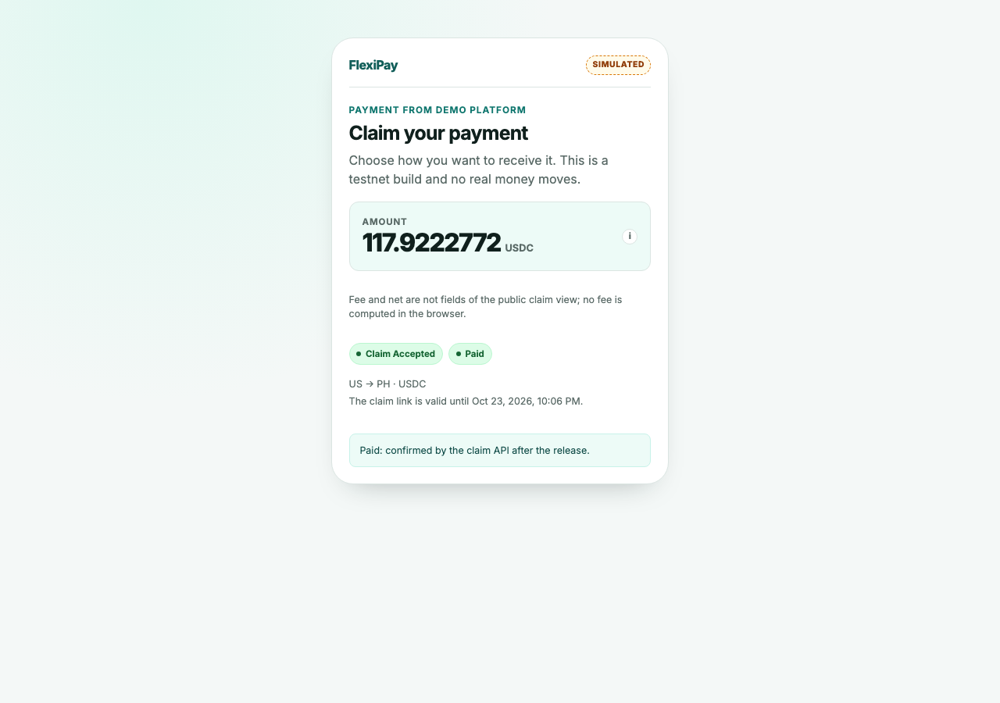

# CCR-11 restart acceptance — Stellar testnet

**Result: PASS** on Stellar testnet. A claim was created and funded in the
browser, the API was stopped and restarted against the same persistent database
and seal key, and the original `open` claim was accepted in a new browser
context. The existing lock was released to the intended Worker A address; no
second funding or lock occurred.

| Item               | Value                                                                                           |
| ------------------ | ----------------------------------------------------------------------------------------------- |
| Base commit        | `b48bfe3` (merge `f4347bd` into lane D)                                                         |
| Acceptance code    | `939a2f9` (lane D; evidence follows in a separate commit)                                       |
| Adapters-sim test  | `528b89b` (cross-lane fix, reported separately)                                                 |
| Runtime            | Node `24.21.0`, npm `11.12.1`, macOS arm64                                                      |
| API                | `http://127.0.0.1:3211`, `FP_SETTLEMENT=stellar`, persistent embedded Postgres on `54333`       |
| Web                | `http://127.0.0.1:5299` through the Vite loopback proxy                                         |
| Stellar            | testnet, vault `CCG232ACW63XVUQGMMA6SWV46W2HIVR2ZSB5ENXHOIIITQBXUBHHIUMN`, deployed fee 100 bps |
| Payment            | `pay_130322f594bcf3c64330e80c`                                                                  |
| Intended recipient | Worker A `GAAN5…PRX5` (masked; full address is public testnet evidence, not repeated here)      |
| Evidence           | this document and `browser/2026-10-23-ccr11-*.png`                                              |

The claim token, claim secret, API key and database URL are not recorded.

## Restart

The database process stayed up on the same data directory. The API launcher,
`DATABASE_URL` and `FP_CLAIM_SEAL_KEY` were unchanged across the restart; no
value is printed here.

| Step                  | Observation                                                 |
| --------------------- | ----------------------------------------------------------- |
| Prepare/fund          | `21:04:22.617Z`–`21:04:34.183Z`, UI create and Fund payment |
| API PID before        | `17059`                                                     |
| SIGTERM / port closed | `21:04:47Z`, health request returned no connection (`000`)  |
| API PID after         | `18539`                                                     |
| New API health        | `200` at `21:05:09Z`                                        |
| Claim expiry          | `21:06:23.450Z`                                             |
| Accept through UI     | `21:05:20.583Z`–`21:05:32.401Z`                             |

The API logged `FlexiPay API listening on :3211` after restart with an empty
stderr log.

## Persistence across the restart

The pre-restart state was read from the API, the database and the public claim
view. The same values were present after the restart and before acceptance:

| Item                    | Before restart                                                     | After restart, before accept |
| ----------------------- | ------------------------------------------------------------------ | ---------------------------- |
| Payment status          | `processing`                                                       | `processing`                 |
| Claim status            | `open`                                                             | `open`                       |
| Claim view              | `open`, payment `processing`, `117.9222772 USDC`                   | same amount and status       |
| Payment `lockAttempt`   | `1`                                                                | `1`                          |
| Settle leg              | `leg_8ac8a12afb65080227dcbcbe`, attempt `1`                        | same id and attempt          |
| Payout id               | `39`                                                               | `39`                         |
| Lock transaction        | `5967fd610160b526f1dbc90ed2f6b2076578bddf2ae28ec4788ba0f2888b9c86` | same hash                    |
| Release transaction     | none                                                               | none                         |
| Sealed claim secret     | 80 bytes, 12-byte nonce, fingerprint `f834feff6b917cfc`            | same ciphertext fingerprint  |
| `payment.funded` events | `1`                                                                | `1`                          |
| Lock `payment.onchain`  | `1`                                                                | `1`                          |

The unchanged sealed ciphertext and the successful decrypt at accept time are
the functional evidence that the same seal key was used. No secret was requested
from the API.

## Acceptance through the UI

After the restart the original claim URL was opened in a **new browser
context**; no funding-page session, cache or in-process map was reused.

| UI observation            | Value                                                              |
| ------------------------- | ------------------------------------------------------------------ |
| Claim status after reopen | `open`                                                             |
| Payment status            | `processing`                                                       |
| Accept submit             | `POST /v1/claims/{token}/accept` → 200                             |
| Claim status after accept | `accepted`                                                         |
| Payment status            | `paid`                                                             |
| Payment after accept      | `paid`, `lockAttempt=1`                                            |
| Release transaction       | `bc455c6ee69ee75024cbe12300fc62baedbb62c05ad291a9681158c64d43e9fb` |
| Settle leg                | same id, attempt `1`, payout `39`                                  |
| Payout leg                | none                                                               |

The browser made exactly two requests after the restart: the public claim view
(`GET /v1/claims/{token}`) and the accept (`POST /v1/claims/{token}/accept`).
Both returned `200`; neither sent an `Authorization` header. The API key stayed
in the Vite dev proxy. The journey used only page navigation, form inputs and
clicks: no `page.route`, no response interception and no manual `fetch` of a
create, fund or accept action. Read-only API/database queries were made outside
the browser after each phase for assertions.

There were **0 console errors** and **0 page errors**.

## On-chain proof

Both transactions were decoded from Stellar testnet RPC `getTransaction`.

| Item                  | Value                                                                                          |
| --------------------- | ---------------------------------------------------------------------------------------------- |
| Lock                  | `5967fd610160b526f1dbc90ed2f6b2076578bddf2ae28ec4788ba0f2888b9c86`                             |
| Lock ledger / status  | `5353177`, `SUCCESS`                                                                           |
| Lock function         | `create_payout` on the configured vault                                                        |
| Lock external id      | `0f00f63c8bc5303de2e1e01a60592dc03ae79d66877bd629cc30d36ff7e9ab8d` = `sha256("<paymentId>:1")` |
| Payout id             | `39`                                                                                           |
| Principal / fee / net | `1179222772` / `11792227` / `1179222772` USDC minor units, `PayerPays`                         |
| Release               | `bc455c6ee69ee75024cbe12300fc62baedbb62c05ad291a9681158c64d43e9fb`                             |
| Release ledger/status | `5353188`, `SUCCESS`                                                                           |
| Release function      | `claim(39, secret, recipient)` on the same vault                                               |
| Claim secret check    | secret hashes to the lock's claim hash                                                         |
| Recipient             | `GAAN5…PRX5`, the intended Worker A address                                                    |

The release is not the lock, and the release's return value is the frozen net.
No second lock was created:

| No-second-lock check       | Before | After |
| -------------------------- | ------ | ----- |
| `lockAttempt`              | 1      | 1     |
| Payout id                  | 39     | 39    |
| Lock transaction           | same   | same  |
| Lock `payment.onchain`     | 1      | 1     |
| `payment.funded` events    | 1      | 1     |
| Settle leg count / attempt | 1 / 1  | 1 / 1 |
| Payout leg count           | 0      | 0     |

## Harness note

A preliminary pass false-failed after the UI had already reached
`accepted / paid`: the saved pre-restart snapshot omitted the settle leg `id`,
so the comparison saw `undefined` instead of a changed row. The payment's chain
release was independently verified, the snapshot was corrected to include the
ID, and the complete create → fund → restart → accept sequence was rerun. The
result recorded above is that clean rerun.

## What remains NOT VERIFIED

- **Stellar fee-drift / orphan-lock recovery is NOT VERIFIED.** No fee drift was
  manufactured and the deployed vault configuration was not changed.
- Mock-mode restart still needs a persistent vault. The in-memory mock vault
  loses payout state across an API restart; this run deliberately used Stellar
  so the lock lives on-chain.
- A different-seal-key negative control was not part of this run.
- This is testnet and loopback only; no push, merge or deployment was performed.
