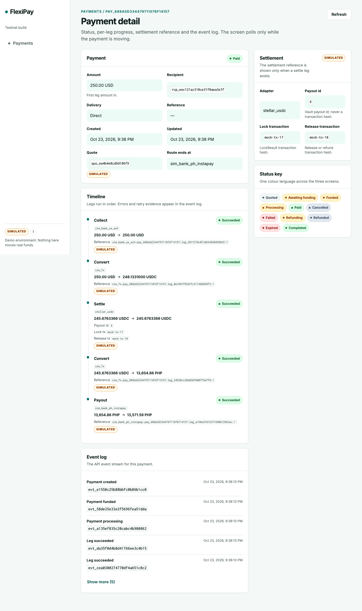
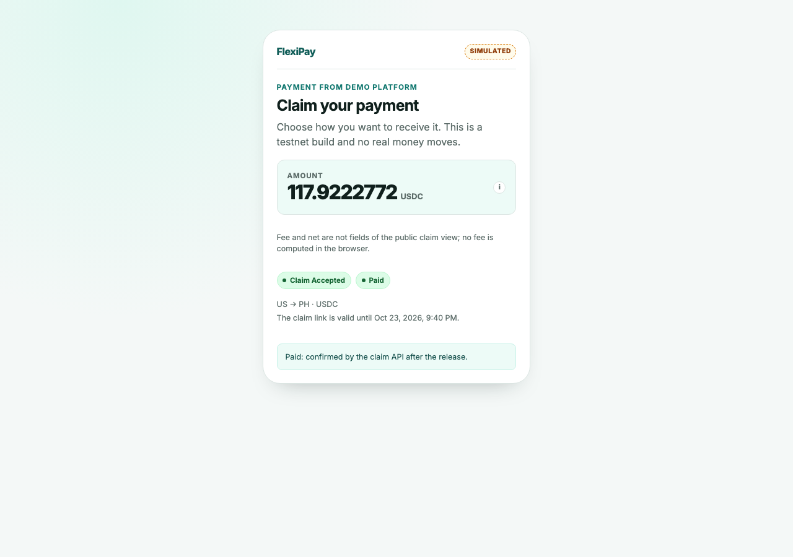
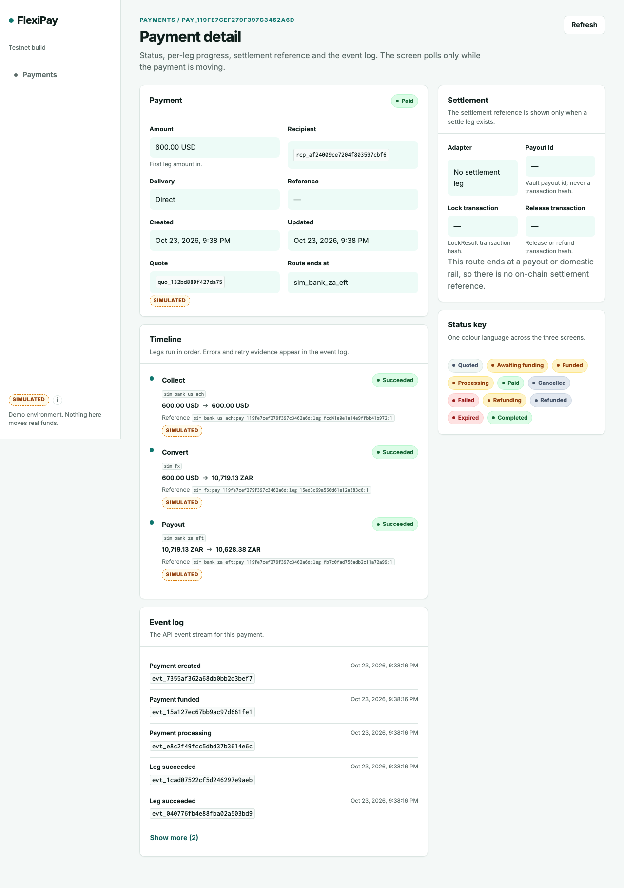

# D1/D2 final acceptance — 23 October 2026

**Result: PASS** for D1 (DF1–DF5) and D2 (seed, replay, offline launcher) on the
lane-D tree, now committed as `939a2f9` on base `b48bfe3`.

| Item                | Value                                                                                                                                     |
| ------------------- | ----------------------------------------------------------------------------------------------------------------------------------------- |
| Integrated HEAD     | `b48bfe3` (merge `f4347bd` into lane D)                                                                                                   |
| Lane-D source patch | `sha256(git diff -- '*.ts') = 249cee56ecf9619c4b3ba23391d85d5691913cbaa4ab7d02d71c8e466313cf07`                                           |
| Working tree        | lane-D changes committed as `939a2f9`; no API, web, Prisma, contract or adapter source was edited                                         |
| Runtime             | Node `24.21.0`, npm `11.12.1`, macOS arm64                                                                                                |
| Mock API            | `http://127.0.0.1:3212`, `FP_SETTLEMENT=mock`, embedded Postgres `54333`                                                                  |
| Stellar API         | `http://127.0.0.1:3211`, `FP_SETTLEMENT=stellar`, same database, testnet vault `CCG232ACW63XVUQGMMA6SWV46W2HIVR2ZSB5ENXHOIIITQBXUBHHIUMN` |
| Offline stack       | API `http://127.0.0.1:8899`, web `http://127.0.0.1:5299`, loopback only, external network denied                                          |
| Evidence            | per-run JSON below is git-ignored; this document and `browser/*.png` are retained                                                         |

The scripts print `commit b48bfe3` because they ran before the lane-D commit.
The source patch hash identifies the exact tested code; the same tree is now
committed as `939a2f9`.

## D1 — flow results

### Mock

`node scripts/demo/run-all.ts` → **exit 0**.

| Flow                             | Result | Evidence JSON                            |
| -------------------------------- | ------ | ---------------------------------------- |
| DF1 three-worker batch           | PASS   | `df1-mock-2026-10-23T20-41-59-373Z.json` |
| DF2 quote → create → fund → paid | PASS   | `df2-mock-2026-10-23T20-41-59-616Z.json` |
| DF3 crypto claim link            | PASS   | `df3-mock-2026-10-23T20-42-01-758Z.json` |
| DF4 retry then refund            | PASS   | `df4-mock-2026-10-23T20-42-02-008Z.json` |
| DF5 ZA company bank route        | PASS   | `df5-mock-2026-10-23T20-42-02-237Z.json` |

Summary printed by the wrapper:

```
DF1  mock     PASS
DF2  mock     PASS
DF3  mock     PASS
DF4  mock     PASS
DF5  mock     PASS
```

### Stellar testnet

`node scripts/demo/run-all.ts --stellar` → **exit 0**.

| Flow                             | Result | Evidence JSON                               |
| -------------------------------- | ------ | ------------------------------------------- |
| DF1 three-worker batch           | PASS   | `df1-stellar-2026-10-23T20-42-59-010Z.json` |
| DF2 quote → create → fund → paid | PASS   | `df2-stellar-2026-10-23T20-43-14-300Z.json` |
| DF3 crypto claim link            | PASS   | `df3-stellar-2026-10-23T20-43-35-052Z.json` |
| DF4 retry then refund            | PASS   | `df4-stellar-2026-10-23T20-43-54-083Z.json` |
| DF5 ZA company bank route        | PASS   | `df5-stellar-2026-10-23T20-43-54-549Z.json` |

Summary printed by the wrapper:

```
DF1  stellar  PASS
DF2  stellar  PASS
DF3  stellar  PASS
DF4  stellar  PASS
DF5  stellar  PASS
```

DF1, DF2 and DF4 executed real testnet settlement (`simulated: false` on the
settle leg). DF5 has no settle leg by design. DF3 and DF4 were independently
decoded from `getTransaction`; the other flows were not independently decoded.

## On-chain proof

### DF3 — lock and release

From the PASS run, `pay_eda449a105f7138fdf59cfcf`:

| Item                  | Value                                                              |
| --------------------- | ------------------------------------------------------------------ |
| Lock                  | `73a27dad3269496cb22c4b29e3e3f5b98f9ca19ff2b8dc9ae726d5da0e62fe05` |
| Release               | `60aa471aae8f61309f14bbce827f33c67cf7647e838911d1ed1bfc82bc4c1be5` |
| Payout id             | `36` (same before and after acceptance)                            |
| Release ledger        | `5352925`, status `SUCCESS`                                        |
| Recipient             | `GAAN5…PRX5` (masked; expected Worker A)                           |
| Principal / fee / net | `1179222772` / `11792227` / `1179222772` USDC minor units          |
| Fee mode              | `PayerPays`                                                        |

Checks that passed: the lock is `create_payout` on the configured vault with
`sha256("<paymentId>:1")`; the release is `claim(36, secret, recipient)` on the
same vault; the secret hashes to the lock's claim hash; the release pays the
configured Worker A address; the lock principal, fee mode, fee and net match the
frozen quote. The funding state was `processing` before acceptance and the
payment became `paid` only after release.

### DF4 — lock then cancel

From the PASS run, `pay_92fbd044df8d79f4204eb6c7`:

| Item                     | Value                                                              |
| ------------------------ | ------------------------------------------------------------------ |
| Lock                     | `92de0826c49c6773ab4507152b74677a3759bdc8da8f0444df048abe4173c107` |
| Refund                   | `0b677585fc727a9bc721816e7e802631efb7020a2e3e53866e95ed02e592c832` |
| Payout id                | `37`                                                               |
| Lock function / ledger   | `create_payout`, ledger `5352928`, `SUCCESS`                       |
| Refund function / ledger | `cancel(37)`, ledger `5352929`, `SUCCESS`                          |
| Lock principal           | `982685643` USDC minor units, `PayerPays`                          |
| Final payment            | `refunded`; payout attempts `1, 2`; no attempt 3                   |

The settle leg's status remains `succeeded` after the cancel; the flow does not
assert it (the contract does not define that status after a refund).

## Live API checks

Run against the offline mock API through the demo client:

| Check                                                      | Result                              |
| ---------------------------------------------------------- | ----------------------------------- |
| Replay `POST /v1/payments` with the same `Idempotency-Key` | same payment id, `awaiting_funding` |
| New payment with an existing `externalId`                  | `409 duplicate_external_id`         |
| Create from a quote after `advance-time` 3600 s            | `422 quote_expired`                 |

## D2 — seed, replay and offline

`node scripts/seed/seed.ts` under the loopback-only sandbox → **PASS**: reset
`200`, 4 recipients, 6 endpoints.

Replay with the same command → **PASS** again: reset `200`, four new recipient
ids, six new endpoint ids. This proves the fixed idempotency key no longer skips
the wipe.

The offline launcher ran under this `sandbox-exec` profile:

```scheme
(version 1)
(allow default)
(deny network-outbound)
(allow network-outbound (remote ip "localhost:*"))
```

- API healthz `200`, web `/` `200`.
- `curl https://example.com` in the same profile: `Could not resolve host`,
  `000`; loopback health `200`.
- `node scripts/demo/run-all.ts` in the same profile → **exit 0**, DF1–DF5 PASS.
- Browser DF2, DF3 and DF5 drove this real API through the Vite proxy.

## Browser evidence

The browser run used the offline stack, not the mocked Playwright fixtures. It
made 21 `/v1/` requests; **0 carried an Authorization header from the browser**
(the Vite proxy holds the key server-side). There were **0 console errors** and
**0 page errors**.

| Flow                           | Result | Screenshot                                                                                        |
| ------------------------------ | ------ | ------------------------------------------------------------------------------------------------- |
| DF2 quote → fund → paid        | PASS   | `browser/2026-10-23-browser-df2-paid.png`                                                         |
| DF3 claim link → accept → paid | PASS   | `browser/2026-10-23-browser-df3-claim-paid.png`, `browser/2026-10-23-browser-df3-detail-paid.png` |
| DF5 ZA company bank route      | PASS   | `browser/2026-10-23-browser-df5-paid.png`                                                         |

The screenshots show the paid status, route, timeline, event log, settlement
references and per-leg `SIMULATED` labels. DF5 shows `sim_bank_za_eft`, no
settle leg and the crypto/company exclusion reason. The web form offers only
bank accounts for ZA, so the DF5 crypto 422 is asserted at API level, not in the
browser.







## Checks

| Command                                          | Exit | Result                                               |
| ------------------------------------------------ | ---- | ---------------------------------------------------- |
| `npm test --workspace @flexipay/api`             | 0    | 50/50                                                |
| `npm test --workspace @flexipay/domain`          | 0    | 72/72                                                |
| `npm test --workspace @flexipay/adapters-sim`    | 0    | 85/85                                                |
| `npm test --workspace @flexipay/adapter-stellar` | 0    | 17 passed, 5 skipped (opt-in testnet)                |
| `npx vitest run tests/e2e/*.test.ts`             | 0    | 74/74                                                |
| `npm test` in `tests/e2e-ui`                     | 0    | 34/34                                                |     | `npm run typecheck --workspaces --if-present` | 0   | all workspaces clean |
| `npx tsc -p scripts/demo/tsconfig.json`          | 0    | demo scripts clean                                   |
| `npx tsc -p scripts/seed/tsconfig.json`          | 0    | seed scripts clean                                   |
| `npm run build`                                  | 0    | web production build clean (chunk-size warning only) |
| `npm run lint`                                   | 0    | clean                                                |
| `npx prettier --check` on changed source files   | 0    | clean                                                |
| `git diff --check`                               | 0    | clean                                                |

## Remaining caveats

1. CCR-11 restart acceptance **passes on Stellar testnet**; see
   `2026-10-23-ccr11-restart-stellar.md`. A mock-mode restart still fails
   because the mock vault is in-memory (`502 release_failed / PayoutNotFound`).
2. The settle leg's status after a vault refund is undefined; DF4 does not
   assert it.
3. DF1/DF2/DF4 prove testnet settlement through API state and events; only
   DF3/DF4 were independently decoded from RPC in this acceptance.
4. No stable refusal-reason code exists; DF5 asserts the explanation's meaning.
5. The lane-D changes are committed as `939a2f9`; the patch hash above
   identifies the tested tree.
